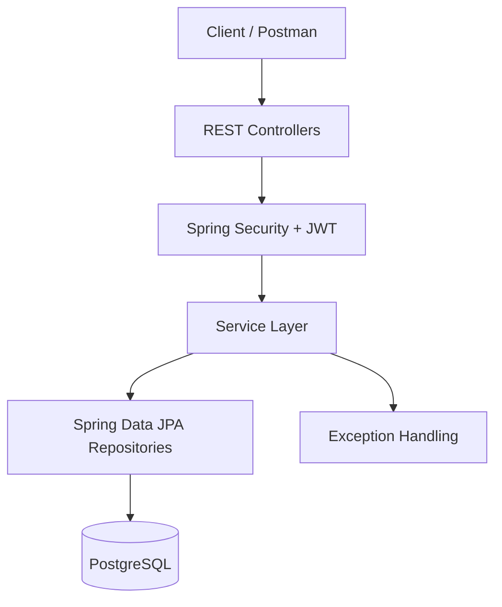

SmartPay – Digital Wallet Management System
SmartPay is a Spring Boot–based digital wallet application built to demonstrate core fintech backend workflows, including user registration, JWT-based authentication, wallet management, adding funds, and wallet-to-wallet transfers.

The application uses PostgreSQL for persistence and Docker Compose to run the application and database together.
Features
- User registration and login.
- JWT-based authentication for protected APIs.
- Automatic wallet creation for registered users.
- Wallet balance and status retrieval.
- Add-money operation.
- Wallet-to-wallet money transfers.
- Insufficient-balance handling.
- Idempotency support for transfer requests.
- Transactional wallet updates and database locking to protect concurrent transfers.
- Unit and integration testing, with JaCoCo coverage reporting.
- GitHub Actions CI workflow.
- Dockerized application using a multi-stage Docker build and a non-root runtime user.
- PostgreSQL data persistence through a named Docker volume.
  Technology Stack
  Area	Technology
  Language	Java 21
  Framework	Spring Boot 3.5.16
  API	Spring Web / REST
  Security	Spring Security, JWT
  Persistence	Spring Data JPA, Hibernate
  Database	PostgreSQL 16
  Build	Maven Wrapper
  Testing	JUnit, Mockito, Testcontainers
  Coverage	JaCoCo
  Containers	Docker, Docker Compose
  CI	GitHub Actions


Architecture
The application follows a layered backend architecture:

Request flow: A client sends an HTTP request to a REST controller. Spring Security validates the JWT for protected operations. The controller delegates business logic to the service layer, which uses JPA repositories to read or update PostgreSQL data. Exceptions are translated into API error responses by the application's exception-handling layer.
Main Workflows
1. Registration: A user registers and receives a user account and wallet.
2. Authentication: The user logs in and receives a JWT access token.
3. Wallet access: The authenticated user can retrieve wallet details and balance.
4. Add funds: Funds are added to the user's wallet through the add-money operation.
5. Transfer: The sender transfers funds to another user using the receiver's email address. The service checks the balance and applies the wallet updates transactionally.
6. Idempotent retry: A transfer request can use an idempotency key so that a retry of the same request does not execute the transfer again.
   Prerequisites
   For running the application with Docker:
- Docker Desktop with Docker Compose v2.
- Git, to clone the repository.
  For running the application directly on your machine:
- Java 21.
- PostgreSQL 16 (or a compatible PostgreSQL version).
  Run with Docker Compose
  The Docker Compose configuration runs the Spring Boot application and PostgreSQL in separate containers.
1. Configure environment variables
   Create a .env file in the project root. Do not commit this file.
   POSTGRES_PASSWORD=replace_with_a_strong_database_password
   JWT_SECRET=replace_with_a_secure_jwt_secret
   Use a suitably strong JWT secret that satisfies the application's signing algorithm requirements. Keep the same database password for an already-initialized PostgreSQL volume unless you deliberately rotate the database user's password inside PostgreSQL as well.

A safe template can be committed as .env.example, containing placeholders only. Add .env to .gitignore.
2. Build the application image
   From the directory containing the Dockerfile:
   docker build -t smartpay-wallet:1.0 .
3. Start the containers
   docker compose up -d
4. Check container status
   docker compose ps
   The PostgreSQL service should report as healthy, and the application container should be running.
5. View application logs
   docker compose logs -f app
6. Access the application
   With the current Compose port mappings:
- Spring Boot API: http://localhost:8081
- PostgreSQL from your host machine: localhost:5433
- PostgreSQL from the application container: postgres:5432
  The database container is reached by the Compose service name postgres from inside the Docker network. Do not use localhost in the application's container-to-database JDBC URL.
7. Stop the containers
   docker compose down
   The database uses a named volume, so stopping/removing the containers this way preserves PostgreSQL data. Do not add -v unless you intentionally want to delete the database volume and its data.

To start the existing containers again:
docker compose up -d
To rebuild the image after changing application code:
docker build -t smartpay-wallet:1.0 .
docker compose up -d --force-recreate app
Run Locally Without Docker
1. Start PostgreSQL and create the application database.
2. Configure the datasource and JWT environment variables expected by application.properties:
   SPRING_DATASOURCE_URL
   SPRING_DATASOURCE_USERNAME
   SPRING_DATASOURCE_PASSWORD
   JWT_SECRET
3. Run the application using the Maven Wrapper.
   On Windows PowerShell:
   .\mvnw.cmd spring-boot:run
   The local application uses the port configured in application.properties.
   Run Tests
   Run the complete test suite from the project root.

On Windows PowerShell:
.\mvnw.cmd clean verify
To run a specific test class:
.\mvnw.cmd -Dtest=WalletServiceImplTest test
JaCoCo coverage reports are generated under the Maven target directory when the configured coverage goals run. Check the build output for the exact report location and coverage rules configured in pom.xml.
Continuous Integration
GitHub Actions runs the Maven build and tests with a PostgreSQL service. Configure the workflow's required database and JWT environment values through workflow configuration or GitHub Actions secrets. Never hardcode real credentials in the workflow file.
API Usage Notes
Use the API paths and request schemas defined by the controllers in this repository. Protected endpoints require the access token returned by login:
Authorization: Bearer <accessToken>
For money transfers, send the receiver's registered email and transfer amount in the request body. Include the idempotency header required by the transfer API when making a transfer request; use a unique key for each distinct transfer and reuse the same key only when retrying that same logical request.
Add an API endpoint table here using the exact @RequestMapping and @PostMapping / @GetMapping paths from the current controllers before publishing the README. Endpoint paths are intentionally not guessed in this document.

## API Endpoints

### Authentication APIs

Base URL: `http://localhost:8081`

#### 1. User Registration

```http
POST /api/v1/auth/register
```

Registers a new user and creates their wallet.

**Request Body:**

```json
{
  "fullName": "Sergio Ramos",
  "email": "sr@gmail.com",
  "mobile": "9812356687",
  "password": "your-password"
}
```

**Example Response:**

```json
{
  "userId": 1,
  "fullName": "Sergio Ramos",
  "email": "sr@gmail.com",
  "mobile": "9812356687",
  "role": "USER",
  "kycStatus": "PENDING",
  "message": "User registered successfully"
}
```

#### 2. User Login

```http
POST /api/v1/auth/login
```

Authenticates the user and generates a JWT access token.

**Request Body:**

```json
{
  "email": "sr@gmail.com",
  "password": "your-password"
}
```

**Example Response:**

```json
{
  "userId": 1,
  "fullName": "Sergio Ramos",
  "email": "sr@gmail.com",
  "role": "USER",
  "accessToken": "<JWT_ACCESS_TOKEN>",
  "tokenType": "Bearer",
  "expiresIn": 3600000
}
```

The generated access token is used to authenticate protected wallet and user APIs.

### Wallet APIs

Base URL: `http://localhost:8081`

All wallet APIs require JWT authentication.

**Authorization Header:**
```http
Authorization: Bearer <accessToken>
```

| Method | Endpoint | Description | Authentication |
|---|---|---|---|
| GET | `/api/v1/wallet/balance` | Retrieve current user's wallet balance | Required |
| POST | `/api/v1/wallet/add-money` | Add money to the wallet | Required |
| GET | `/api/v1/wallet/transactions` | Retrieve paginated transaction history | Required |
| POST | `/api/v1/wallet/transfer` | Transfer money to another user | Required |

#### 1. Get Wallet Balance

```http
GET /api/v1/wallet/balance
```

Returns the authenticated user's wallet details.

**Example Response:**
```json
{
  "walletId": 1,
  "balance": 400.00,
  "currency": "INR",
  "isActive": true
}
```

#### 2. Add Money

```http
POST /api/v1/wallet/add-money
```

**Request Body:**
```json
{
  "amount": 500.00
}
```

Adds the specified amount to the authenticated user's wallet.

#### 3. Get Transaction History

```http
GET /api/v1/wallet/transactions
```

Returns the authenticated user's transaction history.

**Pagination defaults:**
- Page size: 10
- Default sorting: `createdAt` descending

#### 4. Transfer Money

```http
POST /api/v1/wallet/transfer
```

**Required Header:**
```http
Idempotency-Key: transfer-unique-001
```

**Request Body:**
```json
{
  "receiverEmail": "cr7@gmail.com",
  "amount": 100.00
}
```

### User APIs

Base URL: `http://localhost:8081`

All user APIs require JWT authentication.

**Authorization Header:**

```http
Authorization: Bearer <accessToken>
```

#### Get Current User

```http
GET /api/v1/users/me
```

Returns the currently authenticated user's email/username.

**Example Response:**

```text
Authenticated user: sr@gmail.com
```

Transfers money from the authenticated user's wallet to the recipient's wallet.

The idempotency key helps prevent duplicate processing when the same transfer request is retried.

Security Notes
- Keep .env out of version control.
- Never commit database passwords, JWT signing secrets, access tokens, or real user data.
- Use different secrets for local development, CI, and production.
- Use HTTPS and production-grade secret management when deploying outside a local development environment.
  Data Persistence
  Docker Compose stores PostgreSQL data in a named volume. Recreating containers with docker compose down and docker compose up -d should not remove that data. Removing the volume with docker compose down -v deletes the persisted database contents.
  Project Status
  The application has been exercised locally and through Docker for registration, login, wallet retrieval, adding funds, money transfer, insufficient-balance handling, and persistence across container recreation. Automated tests and a GitHub Actions workflow are also configured.
  Author
  Sajid Shaikh
- GitHub: sidhiray